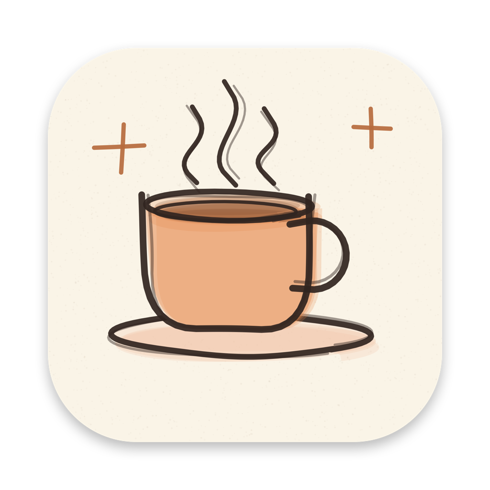

<p align="center">
  
</p>

<h1 align="center">Awake</h1>

<p align="center"><b>Keeps your Mac awake while your AI agents work, then lets it sleep when they're done.</b><br>
A tiny, free, open-source menu bar app. No dependencies, no network access, no tracking.</p>

<p align="center"><a href="https://github.com/valerijaspasojevic/awake/releases/latest/download/Awake.zip"><b>⬇ Download Awake for macOS</b></a><br>
<sub>macOS 13+ · Apple Silicon & Intel</sub></p>

---

## Why

You start Claude Code, Codex or another agent on a big task, walk away, and your Mac goes to sleep halfway through. Awake fixes that without leaving your Mac on all night:

- **Agent mode** (on by default) notices when an agent is *working* and keeps the Mac awake. When all agents finish (or sit idle at their prompt for 10 minutes), the Mac sleeps normally again.
- The **screen can turn off** while the Mac keeps working, which saves power and your display.
- **Safety limits**: by default, agent mode only runs while you're plugged in and stops after 12 hours.
- A **command-line tool** (`awake`) lets scripts and agents control it.

It also does the classic jobs: **Keep Awake** on demand or for a set time, and an optional **Jiggle Mouse** that keeps chat apps showing you as *Active*.

## Install

1. Download **[Awake.zip](https://github.com/valerijaspasojevic/awake/releases/latest/download/Awake.zip)**, unzip it and drag **Awake** into your **Applications** folder.
2. Open it. A ☕ appears in your menu bar. That's it.

> **First launch:** Awake is free and not notarized by Apple, so macOS says it *"could not verify"* the app.
> Click **Done**, open **System Settings → Privacy & Security**, scroll down and click **Open Anyway** next to Awake.
> (On macOS 14 and older: right-click Awake → **Open** → **Open**.) You only do this once.

Optional, from the ☕ menu:
- **Open at Login** to start Awake automatically.
- **Install Command Line Tool…** adds the `awake` command (asks for your password once).

## The menu

| Item | What it does |
|---|---|
| **Keep Awake** / **Keep Awake For…** | Mac and screen stay on, indefinitely or for 30 min to 8 h. |
| **Stay Awake While Agents Work** | Agent mode (see below). |
| **Agent Settings** | Keep Screen On · Ignore Idle Agents · Only When Plugged In · Stop After (4–24 h or no limit) · Watched Agents · a live list of detected agents with their CPU use. |
| **Jiggle Mouse** | When you've been idle for ~25 s, nudges the pointer 1 px and back. Needs Accessibility permission (macOS asks the first time). |

The ☕ icon shows what's happening:

| Icon | Meaning |
|---|---|
| outlined cup | not keeping awake (or paused, e.g. on battery) |
| cup with steam | agents or tasks are working: Mac stays awake, screen may turn off |
| filled cup | Keep Awake is on: Mac and screen stay on |

## Agent mode

Awake checks every 15 seconds for processes named like a known agent:
`claude`, `codex`, `cursor-agent`, `gemini`, `aider`, `goose`, `opencode`, `amp`, `qwen`, `crush`.
Change the list in **Agent Settings → Watched Agents…** or with `awake agents add NAME`.

An agent counts as **working** while it and the tools it runs (tests, builds…) use at least 4% of a CPU core, averaged over 2 minutes. An idle agent at its prompt uses about 1%. After 10 minutes without work, it counts as idle and no longer keeps the Mac awake, so a terminal left open won't keep your Mac up all night. Turn off **Ignore Idle Agents** to keep the Mac awake whenever an agent is open at all.

### Claude Code hooks (most precise)

For Claude Code you can skip the guesswork: these hooks tell Awake exactly when Claude starts and finishes a turn. Install the command line tool first, then add this to `~/.claude/settings.json`:

```json
{
  "hooks": {
    "UserPromptSubmit": [{ "hooks": [{ "type": "command", "command": "awake hook start" }] }],
    "Stop":             [{ "hooks": [{ "type": "command", "command": "awake hook end" }] }],
    "SessionEnd":       [{ "hooks": [{ "type": "command", "command": "awake hook end" }] }]
  }
}
```

Each hook takes a few milliseconds. If Claude Code crashes, the hold ends with it.

## Command line

```sh
awake                         # status
awake status --json           # machine-readable status
awake on                      # keep awake (screen on) until `awake off`
awake on 2h                   # ...for 2 hours (also 90m, 1h30m)
awake off                     # stop (clears `on` and all holds)

awake run -- npm test         # keep awake exactly while a command runs, then exit with its code
awake run --screen -- ./train.sh   # same, keep the screen on too

awake hold backup 3h          # keep awake until released (or for 3 h at most)
awake release backup

awake agents                  # watched names + detected agents with CPU use
awake agents add my-agent
awake agents off              # turn agent mode off (on to turn it back on)
```

`awake run` holds its own sleep lock, so it works even when the app isn't running. Every other command starts the app if needed.

## Good to know

- **Closing a MacBook's lid** puts it to sleep, whatever any app says. For overnight runs, keep the lid open (the screen can still turn off), or use clamshell mode with power and an external display connected.
- **Plugged in only** and **Stop After** apply to agents and holds. *Keep Awake* and `awake run` are always honored, because you asked for them explicitly.
- Awake uses the same mechanism as Apple's built-in `caffeinate`. You can see what it's doing with `pmset -g assertions`.

## How it works

- Keeping awake is a macOS power assertion: `PreventUserIdleSystemSleep` (Mac on, screen may sleep) or `PreventUserIdleDisplaySleep` (screen stays on). Quitting Awake releases it immediately.
- Agent detection reads the process list and CPU time with public APIs (`libproc`, `sysctl`) for your own user's processes only. Nothing leaves your Mac.
- The `awake` command is the same program as the app. It sends commands to the running app as local notifications and reads its status from `~/Library/Application Support/Awake/status.json`.

## Build from source

You need macOS 13+ and the Xcode Command Line Tools (`xcode-select --install`).

```sh
git clone https://github.com/valerijaspasojevic/awake.git
cd awake
./build.sh            # builds ~/Applications/Awake.app (universal); ./build.sh --zip also makes dist/Awake.zip
open ~/Applications/Awake.app
```

```
Sources/main.swift       picks app or CLI mode
Sources/App.swift        menu bar app: menu, settings, power assertion
Sources/Processes.swift  finds agents and measures their CPU use
Sources/CLI.swift        the `awake` command
Sources/Shared.swift     types shared by app and CLI
icon/make_icon.swift     draws the hand-drawn icon in code
```

The app is ad-hoc signed, not notarized. That's fine for apps you build yourself. Downloaded copies need the one-time *Open Anyway* step above.

## License

[MIT](LICENSE). Free to use, change and share.
